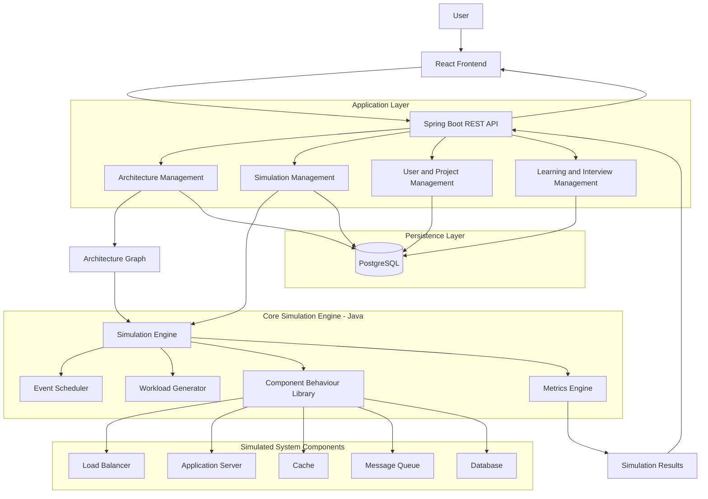
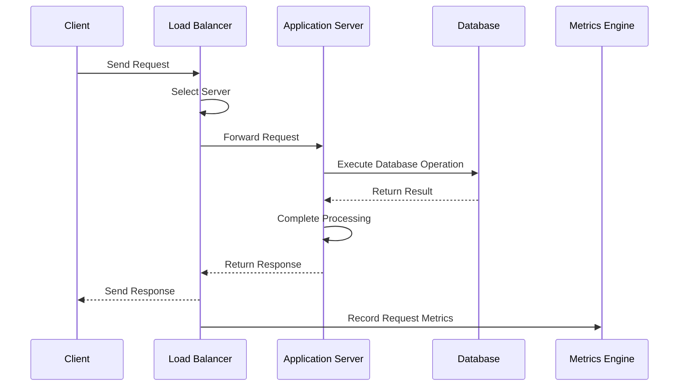

# SysForge
## System Design Document

**Version:** 0.1  
**Status:** Initial Architecture Proposal  
**Backend:** Java + Spring Boot  
**Architecture Style:** Modular Monolith

---

# 1. Introduction

SysForge is an interactive system design learning, architecture simulation and interview practice platform.

The platform allows users to learn system design concepts, construct distributed system architectures, simulate workloads, introduce failures and evaluate the consequences of their architectural decisions.

The backend will be developed using Java and Spring Boot, with a dedicated simulation engine responsible for executing user-defined architectures.

The primary engineering objective is to build a reusable simulation engine capable of modelling different system architectures rather than implementing individual systems independently.

# 2. High-Level Architecture

SysForge will initially follow a modular monolithic architecture.

The application will be divided into logically independent modules with clearly defined responsibilities.

The Spring Boot application will handle API requests, architecture management, simulation orchestration and persistence.

The simulation engine will independently handle event scheduling, component behaviour, request processing and metrics calculation.

## 2.1 Architecture Diagram

The following diagram illustrates the proposed high-level architecture of SysForge.

## 2.2 Architecture Overview

The platform consists of five major layers.

### Presentation Layer
Responsible for user interaction and visualisation.

Components:
- React frontend.
- Architecture graph editor.
- Component configuration interface.
- Simulation controls.
- Metrics dashboards.
- Learning and interview interfaces.

### Application Layer
Responsible for application-level operations.

Components:
- REST API controllers.
- Application services.
- Request validation.
- Simulation orchestration.
- User management.
- Project management.

### Domain Layer
Contains the core business models and rules.

Components:
- Architecture.
- Node.
- Edge.
- Component configuration.
- Simulation configuration.
- Simulation events.
- Simulation results.

### Simulation Layer
Responsible for executing simulated system architectures.

Components:
- Virtual clock.
- Event scheduler.
- Workload generator.
- Component behaviour models.
- Request lifecycle management.
- Failure simulation.
- Metrics engine.

### Persistence Layer
Responsible for storing application data.

Components:
- PostgreSQL.
- Spring Data JPA.
- Architecture storage.
- User and project information.
- Simulation history.

# 3. Core Backend Modules

The backend will be organised into the following logical modules.

## 3.1 Architecture Management

**Responsibility:** Manage user-created system architectures.

Operations:
- Create an architecture.
- Update an architecture.
- Add and remove nodes.
- Add and remove connections.
- Validate graph structure.
- Configure architectural components.
- Save and retrieve architectures.

## 3.2 Simulation Management

**Responsibility:** Coordinate simulation execution.

Operations:
- Accept simulation requests.
- Validate simulation configuration.
- Load architecture definitions.
- Initialise simulation instances.
- Start simulation execution.
- Retrieve simulation results.
- Manage simulation history.

This module will coordinate the simulation engine without containing its core execution logic.

## 3.3 Simulation Engine

**Responsibility:** Execute the architecture defined by the user.

The simulation engine will be implemented as an independent Java module.

Responsibilities:
- Execute discrete events.
- Maintain virtual simulation time.
- Schedule events.
- Process incoming requests.
- Route requests between components.
- Track component states.
- Handle simulated failures.
- Collect execution data.

The engine must remain independent of Spring Boot controllers, HTTP requests and database persistence.

It should be possible to execute and test the simulation engine without starting the entire web application.

## 3.4 Component Behaviour Library

**Responsibility:** Define how individual architectural components behave.

Initial components:

- Client.
- Load Balancer.
- Application Server.
- Request Queue.
- Cache.
- Database.

Each component must define:

- Component identity and type.
- Configurable properties.
- Inputs and outputs.
- Processing behaviour.
- Capacity constraints.
- Latency characteristics.
- Failure conditions.

The component library should support extensibility so that new component types can be introduced without rewriting the simulation engine.

## 3.5 Workload Generator

**Responsibility:** Generate simulated traffic.

Responsibilities:
- Configure request arrival rates.
- Generate incoming requests.
- Define request distributions.
- Support different traffic patterns.
- Simulate traffic spikes.
- Support read and write workloads.

## 3.6 Metrics Engine

**Responsibility:** Calculate and collect simulation performance metrics.

Initial metrics:

- Average latency.
- p50 latency.
- p95 latency.
- p99 latency.
- Throughput.
- Error rate.
- Queue depth.
- Queue lag.
- Resource utilisation.
- Cache hit ratio.

Metrics must be calculated from simulation events and component behaviour.

## 3.7 Failure Simulation

**Responsibility:** Model component failures and degraded behaviour.

Initial scenarios:

- Server failure.
- Database slowdown.
- Increased network latency.
- Cache unavailability.
- Queue congestion.
- Traffic spikes.

The module should eventually support failure propagation and recovery behaviour.

## 3.8 User and Project Management

**Responsibility:** Manage user-owned work.

Operations:
- User management.
- Project creation.
- Architecture storage.
- Architecture retrieval.
- Simulation history.
- Saved configurations.

## 3.9 Learning and Interview Management

**Responsibility:** Support the platform's learning and interview experiences.

Operations:
- Manage learning topics.
- Store system design challenges.
- Provide problem requirements.
- Manage hints and evaluation criteria.
- Store interview attempts and feedback.

# 4. Architecture Graph Model

Every user-created system will be represented as a directed graph.

The graph will consist of nodes and edges.

## 4.1 Nodes

Nodes represent architectural components.

Examples:
- Load Balancer.
- Application Server.
- Cache.
- Database.
- Message Queue.

Each node will contain:

| Property | Description |
|---|---|
| id | Unique node identifier |
| type | Component type |
| configuration | Component-specific properties |
| position | Visual position on the architecture canvas |

The visual position of a node must not directly affect simulation behaviour.

## 4.2 Edges

Edges represent communication paths between components.

Each edge will contain:

| Property | Description |
|---|---|
| id | Unique edge identifier |
| source | Source node identifier |
| target | Destination node identifier |
| configuration | Connection-specific properties |

Edges will eventually support properties such as network latency, bandwidth and communication protocol.

## 4.3 Graph Validation

Before executing a simulation, the architecture graph must be validated.

Validation should include:
- Valid node identifiers.
- Valid component types.
- Valid source and destination references.
- No duplicate edge identifiers.
- Valid component configurations.
- No invalid connections.
- Required components and connections for the selected challenge.

The graph will be interpreted by the simulation engine to determine request flow.

# 5. Simulation Engine Design

The simulation engine is the central engineering component of SysForge.

The initial approach will use **discrete-event simulation**.

Instead of waiting for real requests to complete, the engine maintains virtual time and processes scheduled events in chronological order.

## 5.1 Core Concepts

### Virtual Clock

Maintains the current simulation timestamp.

### Event Scheduler

Schedules and retrieves events according to their execution timestamps.

### Priority Queue

Stores pending events ordered by their scheduled execution time.

### Simulation Events

Represent actions occurring during simulation.

Examples:
- Request arrival.
- Request routing.
- Processing started.
- Processing completed.
- Queue entry.
- Queue exit.
- Component failure.
- Component recovery.

### Component State

Maintains the simulated state of individual components.

Examples:
- Available.
- Busy.
- Failed.
- Processing.
- Idle.

## 5.2 Initial Simulation Flow

1. User creates an architecture.
2. Architecture is submitted to the backend.
3. Graph structure is validated.
4. Simulation configuration is validated.
5. The simulation engine is initialised.
6. Workload generation begins.
7. Events are scheduled using virtual time.
8. The event scheduler processes events chronologically.
9. Component behaviour models process requests.
10. Metrics are collected.
11. Simulation results are returned.

## 5.3 Request Lifecycle

Example request flow:

Client → Load Balancer → Application Server → Database.

The engine should model:

- Request arrival time.
- Routing decisions.
- Queue waiting time.
- Server processing time.
- Downstream operations.
- Response completion time.
- Request success or failure.

The request lifecycle will be expanded as additional components are implemented.

## 5.4 Deterministic Simulation

The initial simulation engine should support deterministic execution.

Given the same:
- Architecture.
- Component configurations.
- Workload.
- Random seed.

The engine should produce reproducible results.

This is important for testing, debugging and comparing architectural configurations.

# 6. Initial Request Lifecycle Diagram

The following diagram illustrates a basic synchronous request-processing flow.

This is an initial request lifecycle. Queueing, caching, retries and failures will be added to the model as the engine evolves.

# 7. Technology Stack

## Backend

| Technology | Purpose |
|---|---|
| Java | Primary
